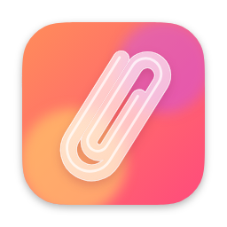
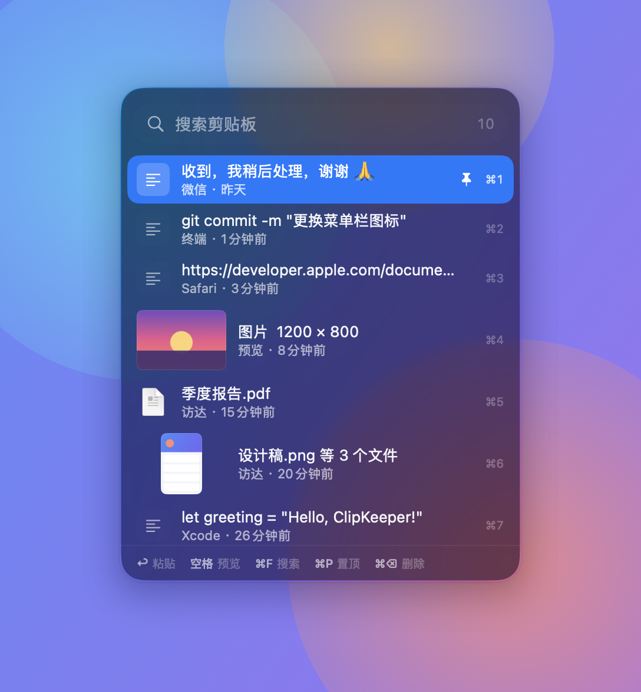
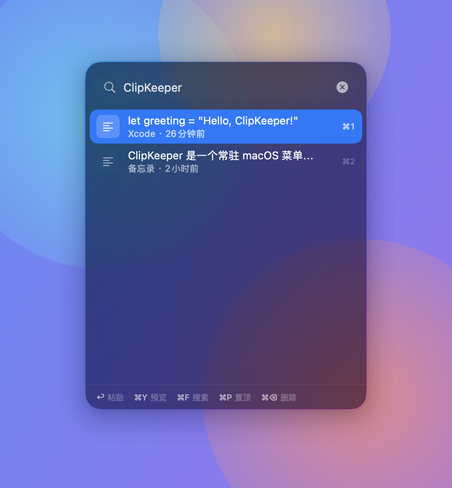
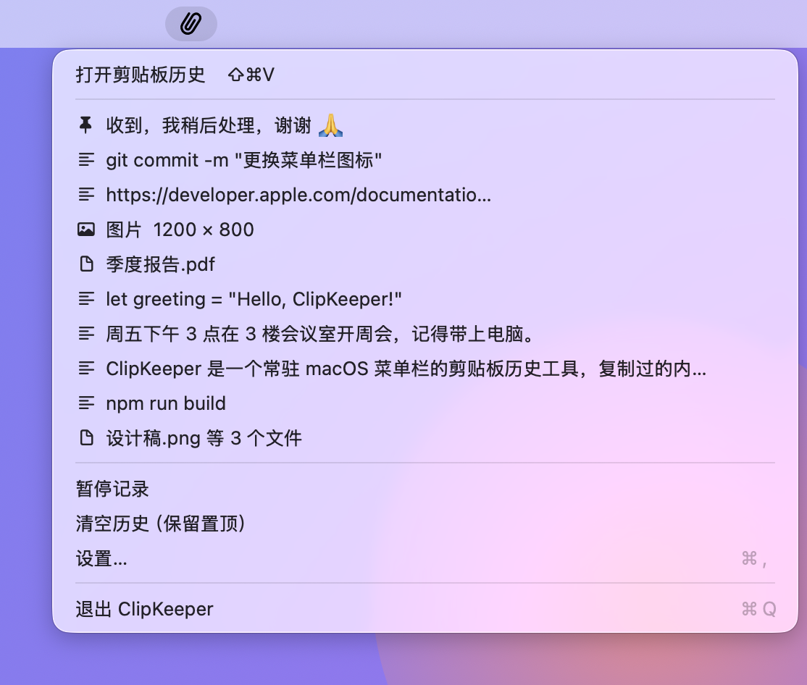
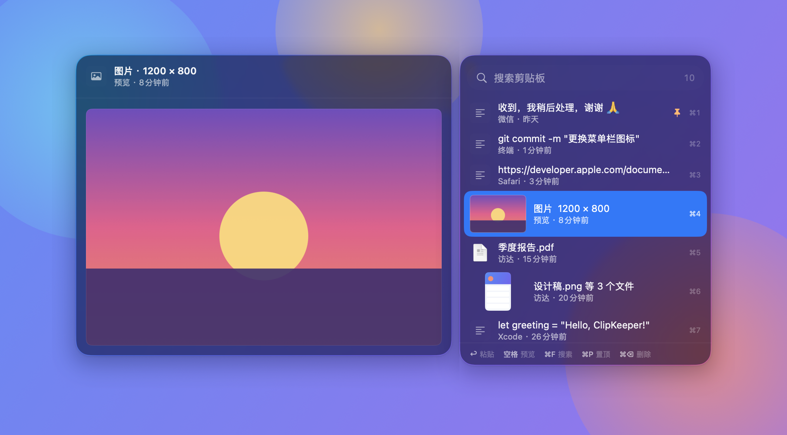
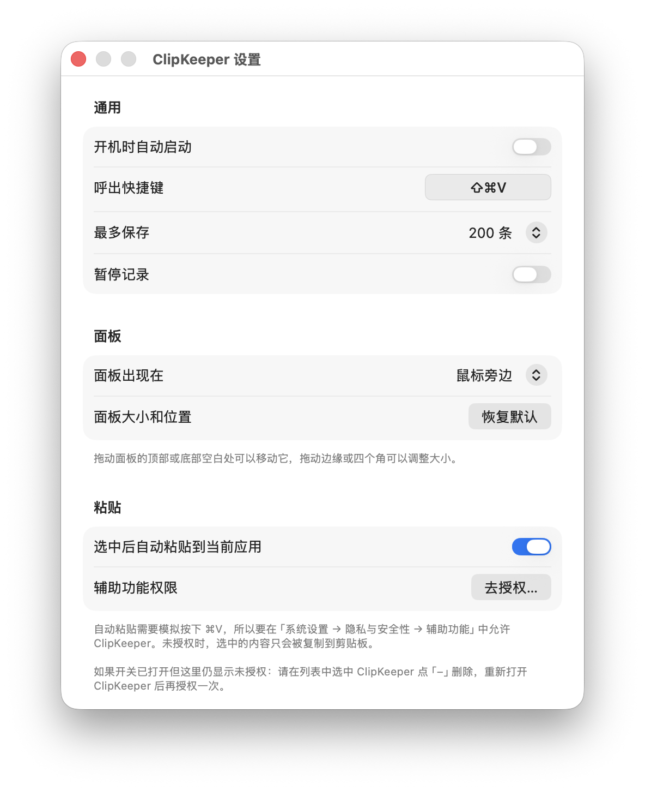

<p align="center">
  
</p>

<h1 align="center">ClipKeeper</h1>

<p align="center">
  一个常驻 macOS 菜单栏的剪贴板历史工具。<br>
  复制过的文本、图片、文件都会被记下来，按 <kbd>⇧</kbd><kbd>⌘</kbd><kbd>V</kbd> 随时找回并粘贴。
</p>

<p align="center">
  
  
  
  
</p>

---

<p align="center">
  
</p>

## 📸 截图

<table>
  <tr>
    <td align="center"><br><sub>点一下搜索框或按 ⌘F 即可搜索</sub></td>
    <td align="center"><br><sub>菜单栏菜单：最近的记录和常用操作</sub></td>
  </tr>
  <tr>
    <td align="center" colspan="2"><br><sub>按空格预览完整内容：长文本、大图、文件列表</sub></td>
  </tr>
  <tr>
    <td align="center" colspan="2"><br><sub>设置：开机自启、自定义快捷键、面板位置、自动粘贴、定时清理、检查更新等</sub></td>
  </tr>
</table>

## ✨ 功能

- **自动记录**：文本、图片、文件（在访达中复制的）都会保存下来，重复内容自动去重
- **随叫随到**：全局快捷键在鼠标旁边弹出浮动面板，点一下搜索框或按 ⌘F 就能搜索；快捷键可以自己录制
- **图片预览**：复制的图片（包括在访达里复制的图片文件）直接在列表里显示预览图
- **大预览**：按空格（或 ⌘Y、右键「预览」）在旁边弹出大预览，查看长文本的全部内容、大图和完整的文件列表
- **一键粘贴**：选中记录后自动粘贴到你正在使用的应用里
- **液态玻璃界面**：在 macOS 26 上使用系统的 Liquid Glass 风格，旧系统自动换成毛玻璃
- **随意摆放**：面板可以拖动、调整大小，会记住你上次的设置
- **置顶常用内容**：置顶的记录排在最前面，超出保存条数时也不会被删除
- **定时清理**：可以自动删除 N 天以前的记录，置顶的记录要不要一起清理由你决定
- **保护隐私**：自动忽略 1Password 等密码管理器复制的密码，也可以指定不记录某些应用；随时可以暂停记录
- **贴心设置**：开机自启、自定义快捷键、最多保存条数、面板出现位置
- **一键更新**：每天自动检查新版本，下载、安装、重新打开一步完成；升级后辅助功能授权会保留

## 💻 系统要求

- macOS 14 Sonoma 或更高版本（在 macOS 26 上体验最佳）
- 从源码编译需要 Xcode 26 或更高版本（用到了 macOS 26 SDK 中的液态玻璃 API；开发时使用的是 Xcode 27）

## 📦 下载安装

1. 在 [Releases 页面](https://github.com/sunnyoung0211/ClipKeeper/releases) 下载最新的 `ClipKeeper-x.y.z.dmg`
2. 打开 DMG，把 **ClipKeeper** 拖到旁边的「应用程序」文件夹
3. 打开「应用程序」里的 ClipKeeper

> [!NOTE]
> 这个应用暂时没有经过 Apple 公证，第一次打开时系统会提示"无法验证开发者"。请点「完成」关掉提示，然后打开
> **系统设置 → 隐私与安全性**，在最下面的「安全性」部分点 ClipKeeper 旁边的 **仍要打开**，输入电脑密码确认即可，以后就不会再提示了。
>
> 熟悉终端的话，也可以用这条命令代替：`xattr -dr com.apple.quarantine /Applications/ClipKeeper.app`

装好后，屏幕右上角的菜单栏会出现一个回形针图标，按 <kbd>⇧</kbd><kbd>⌘</kbd><kbd>V</kbd> 打开剪贴板历史。

**升级**：从 v0.1.2 开始，可以在「设置 → 更新」里点「检查更新」，发现新版本后点「下载并安装」，
ClipKeeper 会自动下载、替换并重新打开，不用再手动下载 DMG。从 v0.1.3 开始还会每天自动检查一次，
有新版本时菜单栏菜单的最上面会出现提示。（v0.1.1 需要手动下载安装一次新版本。）

> 从 v0.1.3 开始，每个版本都用同一张证书签名，升级后自动粘贴的授权会保留。
> 从 v0.1.2 或更早的版本升级到 v0.1.3 时，还需要最后一次重新授权：在「系统设置 → 隐私与安全性 → 辅助功能」里
> 选中 ClipKeeper，点 `−` 删掉，再重新打开 ClipKeeper 授权一次即可。

## 🚀 从源码编译

### 1. 获取代码

```bash
git clone https://github.com/sunnyoung0211/ClipKeeper.git
cd ClipKeeper
```

### 2. 配置代码签名（推荐，可跳过）

项目默认使用"临时签名"，clone 下来就能直接编译运行。但临时签名每次重新编译都会变，
自动粘贴需要的辅助功能授权会跟着失效（见下面的「[辅助功能权限](#-辅助功能权限)」），所以推荐换成你自己的开发者证书：

1. 打开 Xcode，菜单 `Xcode → Settings… → Accounts`，点左下角 `+` 登录你的 Apple ID（免费账号即可）
2. 在终端运行下面的命令查看你的团队 ID，输出里 `OU=` 后面那一串就是：
   ```bash
   security find-certificate -c "Apple Development" -p | openssl x509 -noout -subject
   ```
3. 把 `Config/Local.example.xcconfig` 复制一份，改名为 `Config/Local.xcconfig`，把里面的 `你的团队ID` 换成上一步查到的 ID

`Config/Local.xcconfig` 已被 `.gitignore` 忽略，你的团队 ID 不会被提交到仓库。

> [!WARNING]
> 不要在 Xcode 的 `Signing & Capabilities` 界面里直接选择 Team，那样 Xcode 会把团队 ID 写进项目文件，提交时就会被公开。

### 3. 运行

**用 Xcode（推荐，适合学习和调试）**：按 <kbd>⌘</kbd><kbd>R</kbd>。菜单栏右上角会出现 ClipKeeper 的图标；它不会出现在程序坞里，这是正常的。

**用命令行**：

```bash
./scripts/build.sh --run       # 编译并运行
./scripts/build.sh --install   # 编译并安装到"应用程序"文件夹（日常使用推荐）
```

## 📖 使用方法

### 面板快捷键

| 按键 | 作用 |
|---|---|
| <kbd>⇧</kbd><kbd>⌘</kbd><kbd>V</kbd> | 打开 / 关闭面板（可在设置里更换） |
| <kbd>↑</kbd> <kbd>↓</kbd> | 上下选择 |
| <kbd>↩</kbd> | 粘贴选中的记录 |
| <kbd>空格</kbd>（搜索框为空时）/ <kbd>⌘</kbd><kbd>Y</kbd> | 打开 / 关闭预览，上下选择时预览跟着切换 |
| <kbd>⌘</kbd><kbd>F</kbd> | 开始搜索（光标移到搜索框里） |
| <kbd>⌘</kbd><kbd>1</kbd> ~ <kbd>⌘</kbd><kbd>9</kbd> | 直接粘贴第 1 ~ 9 条 |
| <kbd>⌘</kbd><kbd>P</kbd> | 置顶 / 取消置顶 |
| <kbd>⌘</kbd><kbd>⌫</kbd> | 删除 |
| <kbd>esc</kbd> | 关闭预览 / 关闭面板 |
| 单击 | 选中这条；再单击已选中的那条（或者双击）就粘贴 |
| 右键 | 更多操作：仅复制不粘贴、预览、置顶、删除 |

打开面板时搜索框不会自动获得焦点：**要搜索请先点一下搜索框，或者按 <kbd>⌘</kbd><kbd>F</kbd>**。没点搜索框时，除了上面这些快捷键，
其他按键（直接打字、<kbd>⌘</kbd><kbd>V</kbd> 等）都会关掉面板，并把按键交还给你原来在用的应用，就像面板没打开过一样。

### 更换呼出快捷键

在设置里点一下「呼出快捷键」右边的按键框，然后直接按下想要的组合（比如 <kbd>⌃</kbd><kbd>⌥</kbd><kbd>V</kbd>）就保存好了，按 <kbd>esc</kbd> 取消。
旁边的 ↺ 按钮可以恢复默认的 <kbd>⇧</kbd><kbd>⌘</kbd><kbd>V</kbd>。

为了不影响日常使用，下面这些组合不能用，录制时会提示原因：

- 没有 <kbd>⌘</kbd>、<kbd>⌥</kbd>、<kbd>⌃</kbd> 中任何一个（<kbd>F1</kbd> ~ <kbd>F20</kbd> 除外，可以单独使用）
- 只用 <kbd>⌘</kbd>，比如 <kbd>⌘</kbd><kbd>C</kbd>：会和应用里的常用快捷键冲突
- 只用 <kbd>⌥</kbd> 或 <kbd>⌥</kbd><kbd>⇧</kbd>：这些组合是用来输入特殊字符的
- 已经是系统快捷键（「系统设置 → 键盘 → 键盘快捷键」里开启的），比如 <kbd>⌃</kbd><kbd>空格</kbd>

### 调整面板

- **移动**：拖动顶部搜索框周围的空白处，或者底部的提示栏
- **调整大小**：拖动四条边或四个角（最小 300×260，最大 640×820）
- **出现位置**：在设置里选择「鼠标旁边」（默认）或「上次的位置」，也可以一键恢复默认大小

### 菜单栏菜单

点击菜单栏的回形针图标，可以看到最近 10 条记录，以及暂停记录、清空历史、打开设置等操作。暂停记录时，回形针右下角会出现暂停标记。

## 🔐 辅助功能权限

**自动粘贴**的原理是先把内容放进剪贴板，再模拟按下 <kbd>⌘</kbd><kbd>V</kbd>。macOS 要求你手动授权这项能力：

> 系统设置 → 隐私与安全性 → 辅助功能 → 打开 ClipKeeper

没有授权时，选中的内容只会复制到剪贴板，需要你自己按 <kbd>⌘</kbd><kbd>V</kbd>。设置窗口里会显示当前的授权状态。
（没点搜索框就打字时，把按键交还给原来的应用也要用到这项权限。）

> [!IMPORTANT]
> 使用临时签名（项目默认）时，签名**每次重新编译都会变**，macOS 会把它当成一个新应用，
> 于是会出现"系统设置里开关明明开着，却还提示需要授权"。按照上面「配置代码签名」换成你自己的开发者证书后，
> 签名就固定了，授权不会再失效。
>
> 如果已经遇到这个问题：在辅助功能列表里选中 ClipKeeper，点 `−` 删除，重新运行后再授权一次即可。

## 💾 数据存储

所有数据只保存在本机，不会上传到任何地方：

```
~/Library/Application Support/ClipKeeper/
```

在设置里点「在访达中打开数据文件夹」可以直接打开它。删除这个文件夹就能清空所有数据。

在设置的「数据」里可以开启**自动清理旧记录**：选好清理多久以前的记录（1 天 ~ 365 天），
最后一次复制或使用在那之前的记录会被自动删除（开启时立即清理一次，之后每小时检查一次）。
置顶的记录默认保留，也可以选择一起清理。
